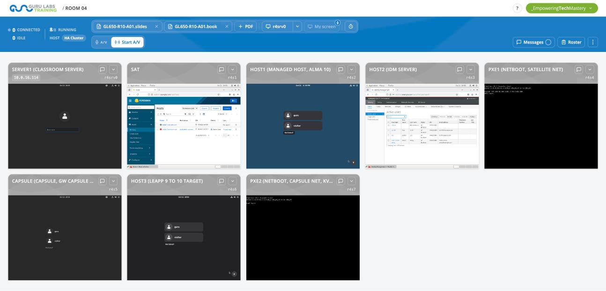
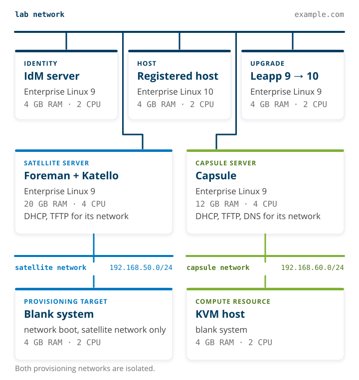

# Foreman training materials

This page lists the materials available for those wishing to study/practice working
with Foreman, as an alternative style to reading the manual.

## Adfinis SyGroup Training Course

OPEN MATERIALS &middot; SLIDES, EXERCISES AND DEMOS

This [training][adfinis-slides] by [Adfinis SyGroup][adfinis] gives a basic
overview of Foreman and its concepts. It covers the installation, configuration
and basic components. Beside the instructor slides the course also contains
hands-on exercises and demos.

The content is available on [GitHub][adfinis-github] and any contributions are
more than welcome!

[adfinis]: https://adfinis-sygroup.ch/
[adfinis-slides]: https://docs.adfinis-sygroup.ch/public/trainings/#training-Foreman
[adfinis-github]: https://github.com/adfinis-sygroup/adsy-trainings

## betadots Training Course

3 DAYS &middot; GERMAN &middot; INSTRUCTOR-LED &middot; OPEN MATERIALS

The [training][betadots-training] by [betadots][betadots] is designed as a three-day
hands-on training in German language. It covers topics from the initial installation
over content management with Katello, integration of configuration management and
provisioning to plugins including their Hiera data manager and advanced topics.

They provide [courses][betadots-schedule] together with training partners like Linuxhotel in Essen or
Heinlein Academy in Berlin regularly. Also remote trainings are available as direct order.

[betadots]: https://www.betadots.de
[betadots-training]: https://github.com/betadots/foreman-training
[betadots-schedule]: https://www.betadots.de/training

## Guru Labs Training Course

5 DAYS &middot; INSTRUCTOR-LED &middot; ONLINE, IN PERSON OR ONSITE

The [GL650 - FOREMAN/KATELLO ADMINISTRATION][GL650] is a 5-day instructor-led course on Foreman 3.18 and Katello 4.20, the releases behind Red Hat Satellite 6.19, with EL10 managed hosts. Its 31 hands-on labs cover installation and tuning, foreman-maintain and backups, organizations, locations and RBAC, content management (Simple Content Access, sync plans, alternate content sources, lifecycle environments, composite and rolling content views, multiple content view environments per host, errata and incremental updates, container and bootable container images), global registration, remote execution over SSH and pull mode, job templates and webhooks, configuration management with Ansible, IdM integration for realm enrollment and DNS, provisioning with PXE, UEFI HTTP boot, Discovery, templates and host groups, image mode (bootc) hosts, Smart Proxies, Inter-Satellite Sync for disconnected sites, and Leapp upgrades from EL9 to EL10. Where Foreman/Katello and Satellite differ, the course teaches both.

The class is [regularly scheduled][schedule] and offered online, in person, or onsite. Labs run in LabConsole, the Guru Labs browser-based classroom. Each student gets seven machines on isolated networks: a Foreman/Katello server, a Smart Proxy for a remote site, an IdM server, managed hosts, and two blank machines that PXE boot from the Foreman server and the Smart Proxy. Students use each machine's console, power and network boot from the browser, and the instructor sees every student's screen live.

  

    
    
Example lab environment

  

  

    
    
Lab topology

  

[GL650]: https://gurulabs.com/training/courses/GL650/
[schedule]: https://gurulabs.com/training/schedule/

## NETWAYS Training Course

2 DAYS &middot; OPEN MATERIALS &middot; SLIDES, HANDOUTS, EXERCISES AND SOLUTIONS

This course was developed by NETWAYS and made available to the Foreman
community for use in developing training courses of their own, or for community
members to use for self-study. It is designed as a two-day hands-on training
course, and as well as the presentation below, it comes with
[handouts][handouts], [exercises][exercises], and [solutions][solutions].

[handouts]: https://github.com/NETWAYS/foreman-training/releases/download/v1.10/foreman-training-handouts.pdf
[exercises]: https://github.com/NETWAYS/foreman-training/releases/download/v1.10/foreman-training-exercises.pdf
[solutions]: https://github.com/NETWAYS/foreman-training/releases/download/v1.10/foreman-training-solutions.pdf

A full-page version of the presentation can be found at
[netways.github.io/foreman-training/][rendered]

[rendered]: //netways.github.io/foreman-training/static

  

    

      <iframe class="embed-responsive-item" src="//netways.github.io/foreman-training/" allowfullscreen></iframe>
    

  

The source for this training material, along with handouts and
excercises/solutions can be found on the [NETWAYS GitHub page][source].
Contribution to improve the source material is welcome!

[source]: https://github.com/NETWAYS/foreman-training
